# About me

Hi, I'm a web developer and automation engineer from Hamburg. I like building clean UIs, automating everything that's annoying to do twice, and in my spare time I do GTA game modding.

# Stuff I did (projects)

## Legacy (closed source)

**German open.mp server · 2024–2026 · 600 registered user accounts**

Legacy was a German multiplayer server for GTA San Andreas, running on open.mp. Around the game server I built the tools players used every day: a desktop launcher, a community website with a control panel, interactive setup guides, a login theme and the forum design.

| Area | What it is | Stack |
| --- | --- | --- |
| [Launcher](#launcher) | Desktop app to start the game and manage mods |   |
| [Control Panel](#control-panel) | Community website connected to the game database |     |
| [Keycloak Theme](#keycloak-theme) | Custom login and registration pages |   |
| [open.mp Install & Connection Guide](#openmp-install--connection-guide) | Animated setup guide, built entirely for the web |   |
| [Windows Security Settings Animations](#windows-security-settings-animations) | Animated troubleshooting for common Windows issues |   |
| [Forum](#forum) | Custom forum design |  |

---

### Launcher

Desktop launcher for a SA:MP / open.mp server.

- Server and player status, TeamSpeak indicator
- News feed from the forum
- GTA SA path management and one-click game start
- Player list with search and filters for factions, gangs and civilians
- Mod manager: install/remove, categories, search, sharing, import and backups, ASI loader detection

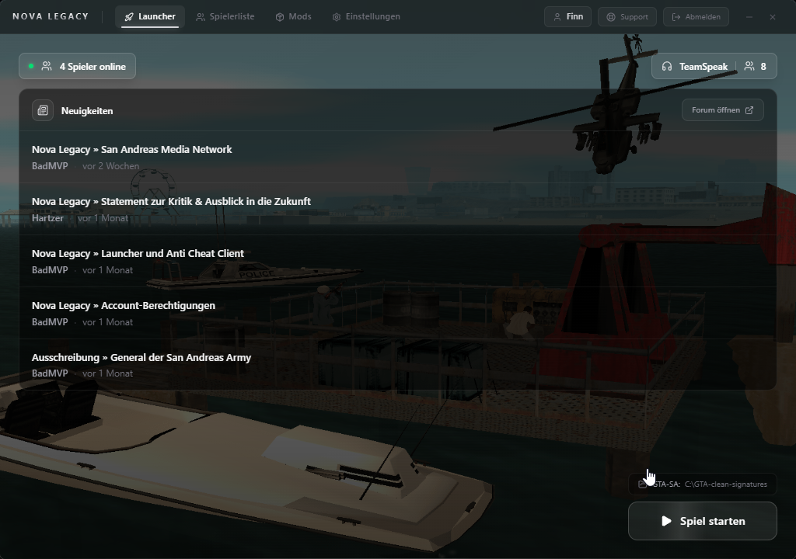

  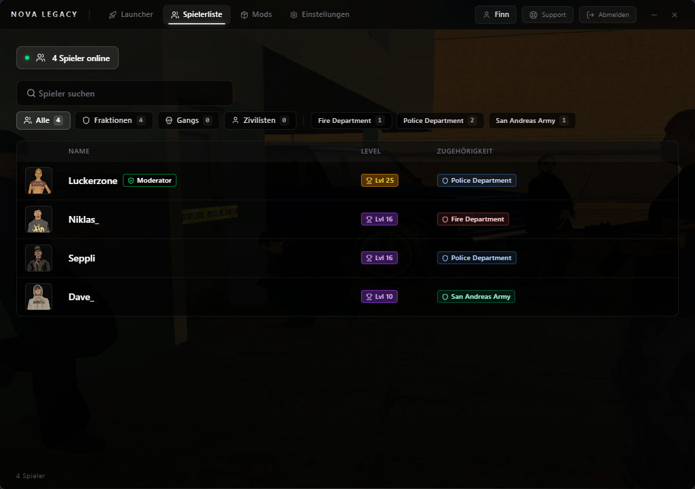
  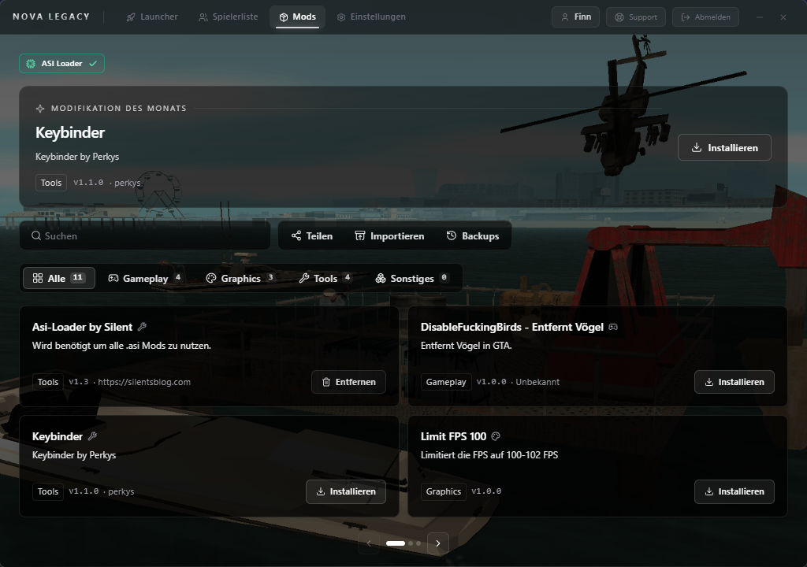

`300–400 downloads`

---

### Control Panel

Community website and control panel for the server, connected to the game database.

- Landing page with background video, a faction showcase and feature sections
- Factions overview: legal vs. criminal with live player counts and faction profiles
- Server contests: live, scheduled and finished contests with progress, rewards and top players
- Event calendar: monthly view of all server events
- Player profiles, stats, achievements, leaderboards and an interactive map
- Admin panel for moderation, logs and content

  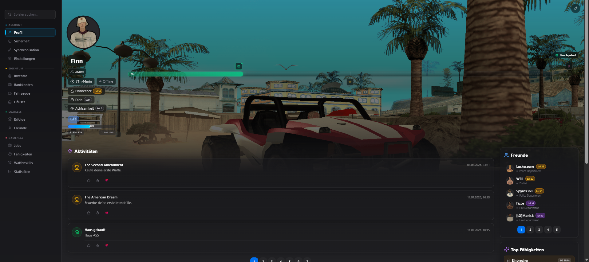
  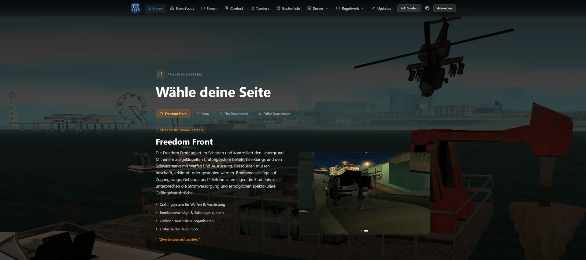

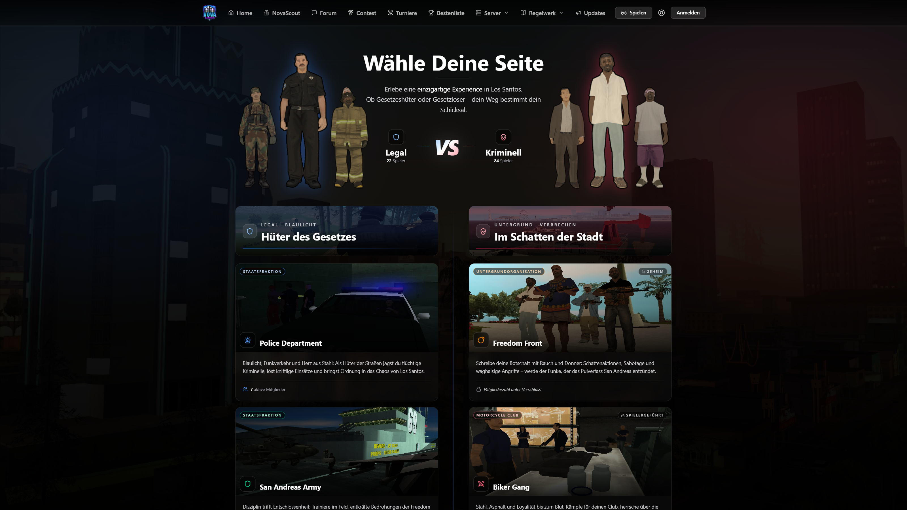

  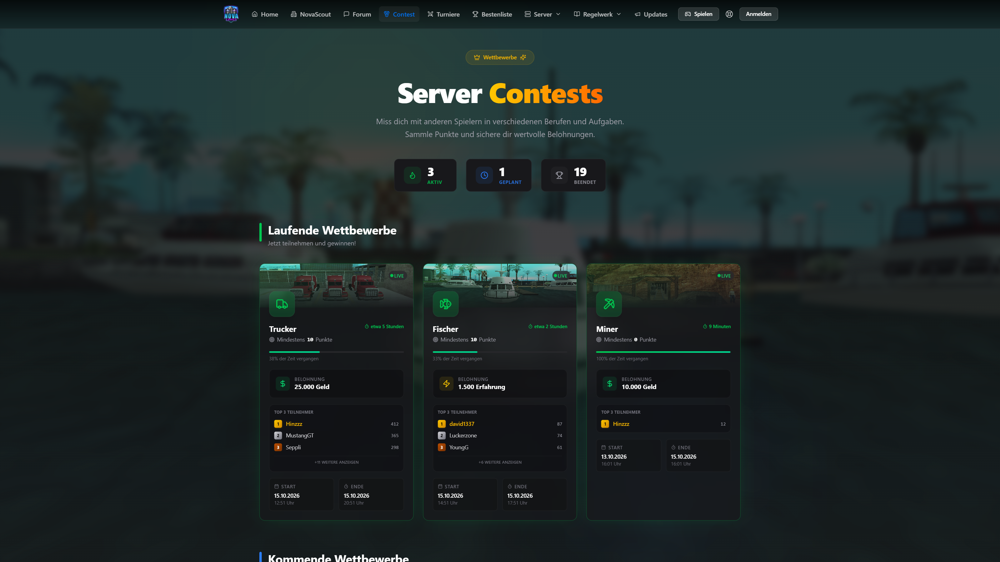
  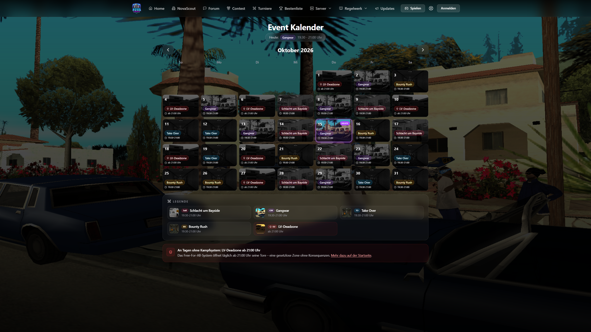

---

### Keycloak Theme

Custom theme for the Keycloak login and registration pages.

- Login with username or email, password reset
- Registration with in-game name, terms acceptance and reCAPTCHA
- Carousel showcasing game content next to the form

  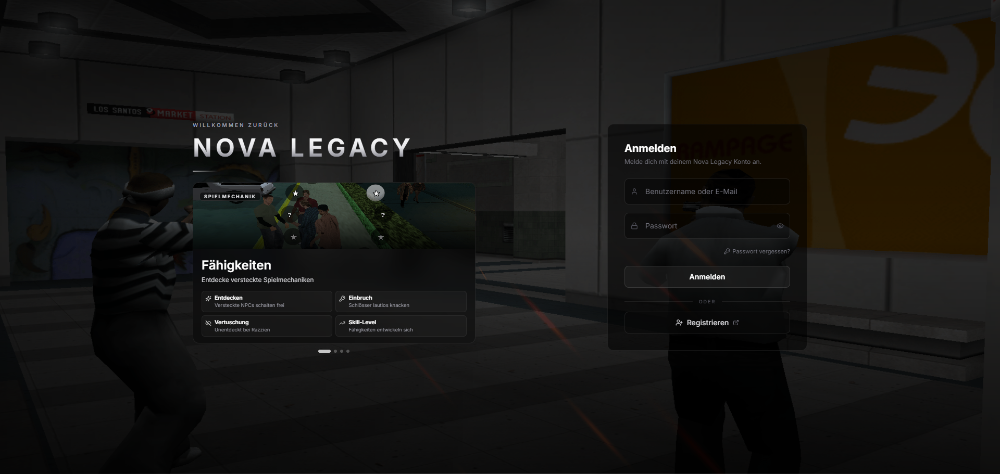
  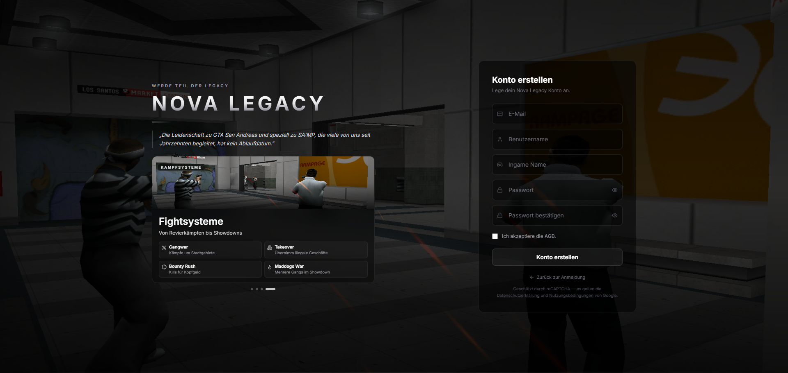

---

### open.mp Install & Connection Guide

Interactive guide from download to the first server connection. It's built entirely for the web: no screen recordings and no video files, just code that runs in the browser.

- Browser, installer and open.mp launcher rebuilt as React components with Tailwind CSS
- A TypeScript timeline scripts cursor movement, clicks and every UI state
- Transitions with Framer Motion, icons with Lucide
- Starts when scrolled into view (IntersectionObserver), then loops
- `No video assets to maintain: sharp at any size, and text changes are a code edit`

  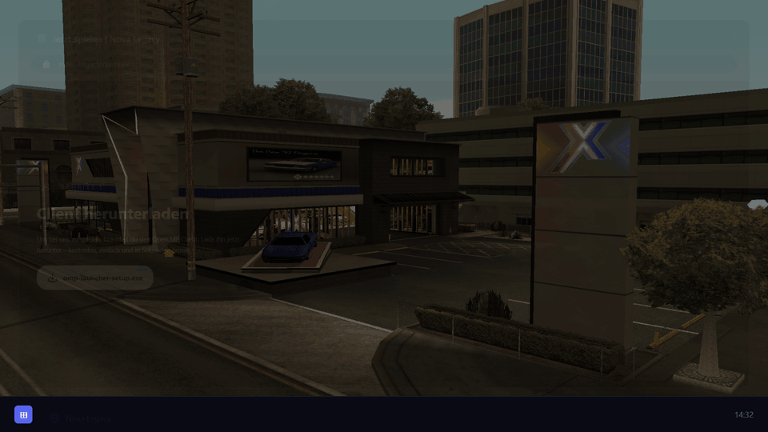
  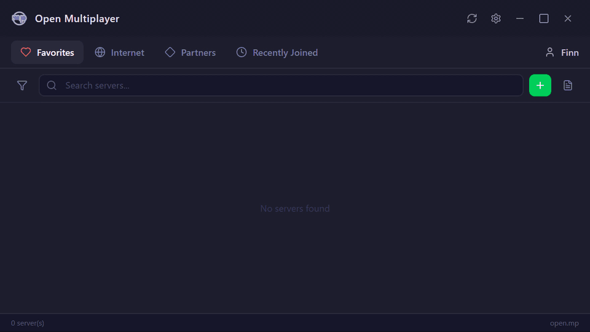

  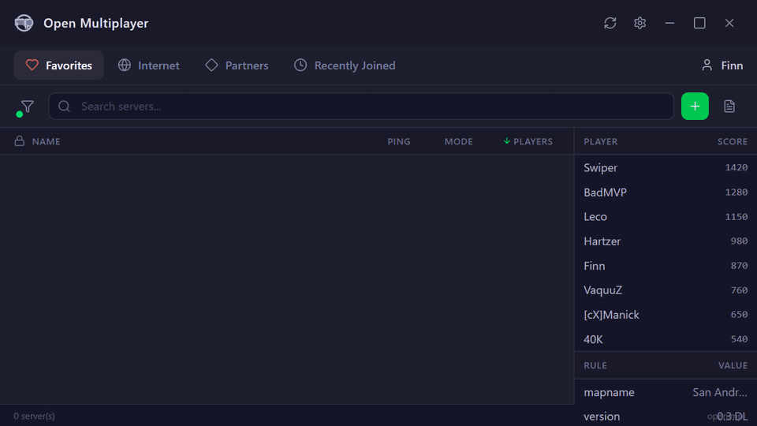

---

### Windows Security Settings Animations

Troubleshooting help for the most common Windows problems when starting the game. Windows dialogs are recreated in React and walk the player through each fix.

- Run as administrator: fixes open.mp starting singleplayer instead of multiplayer
- Windows Security: adds an antivirus exclusion when open.mp is flagged as a virus
- File Explorer: unpacks the texture pack into `samp\cache` when custom textures don't load

  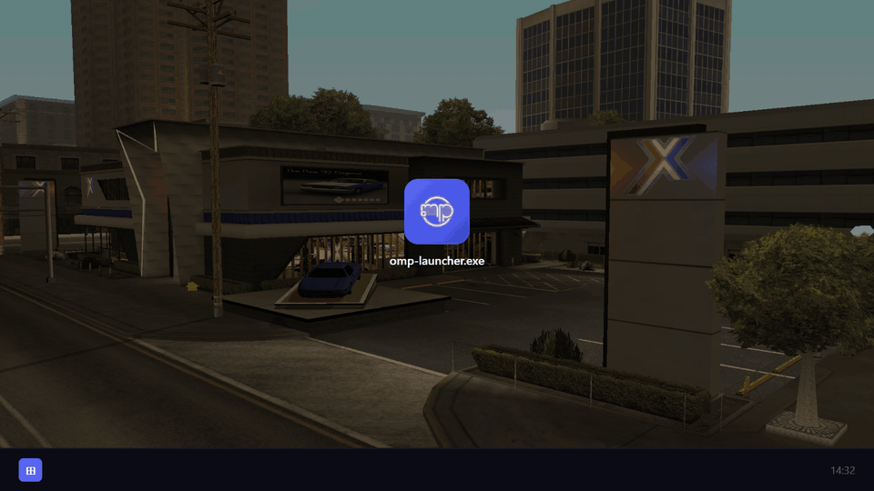
  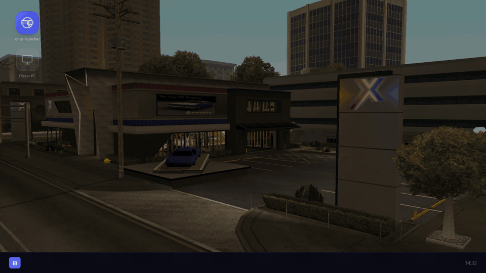

  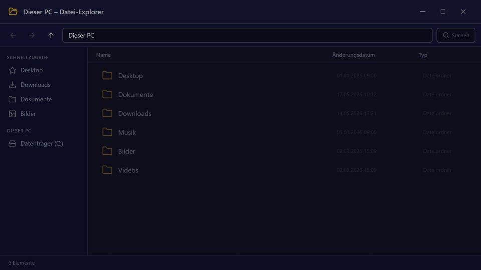

---

### Forum

Custom design for the community forum, built on WoltLab Suite.

- Sections for announcements, events, changelogs and suggestions
- Shared navigation with website, dashboard, rules and roadmap
- News also shows up in the launcher

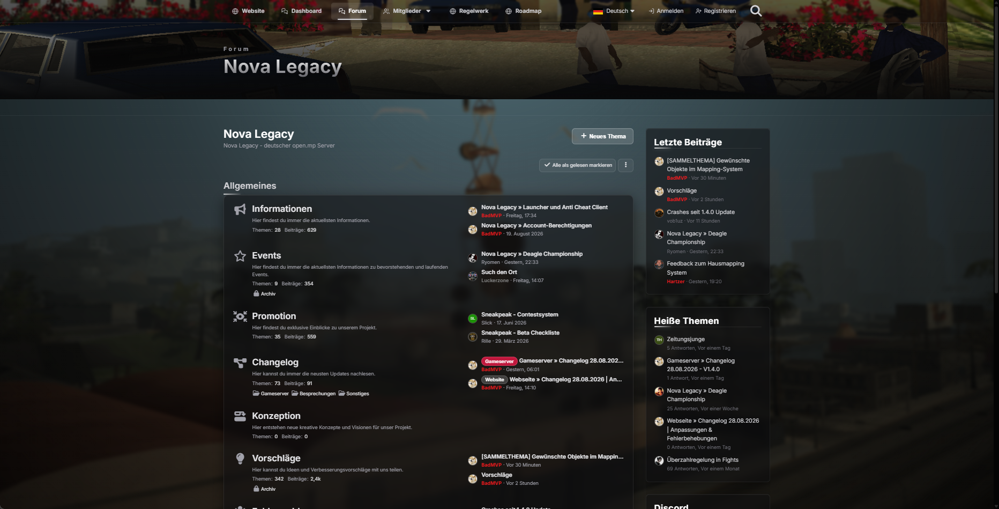
